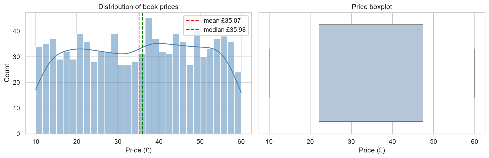
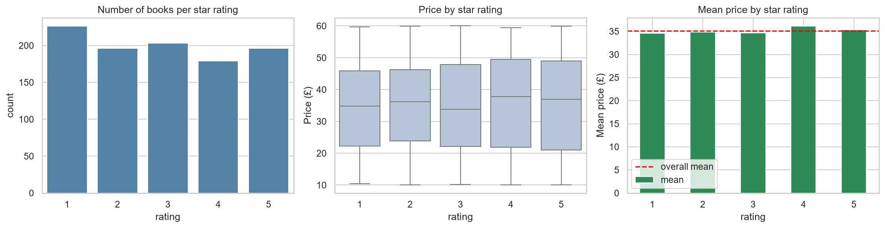
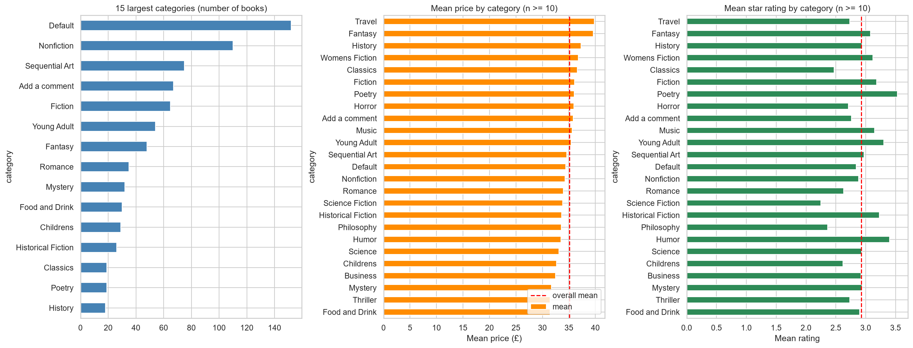
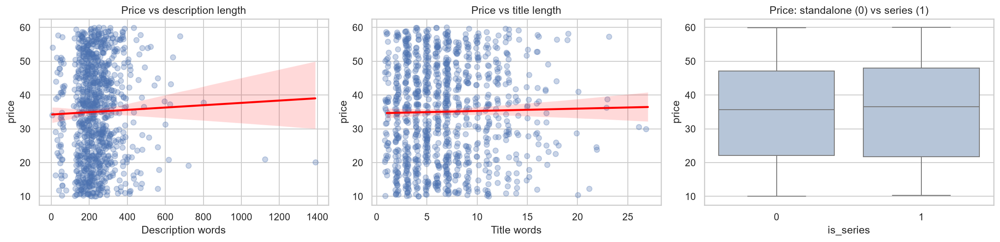
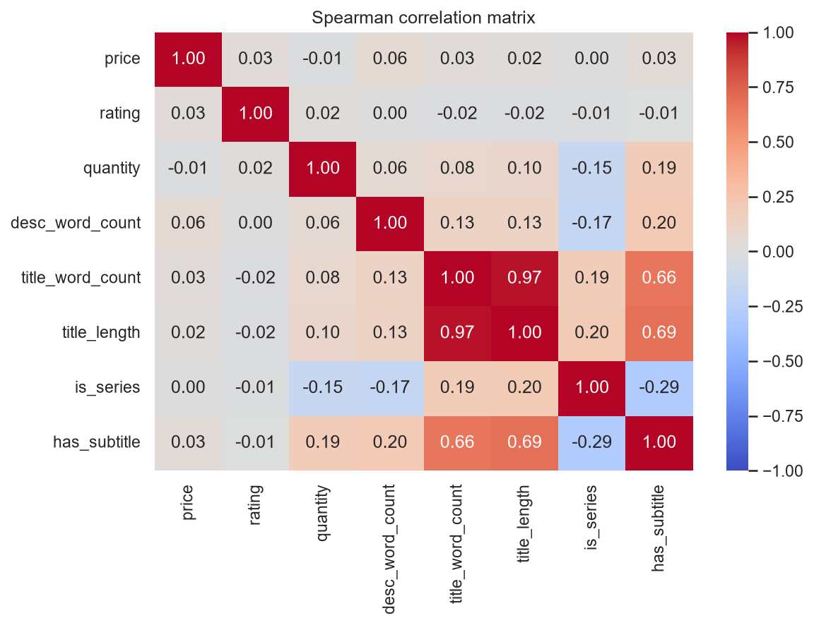
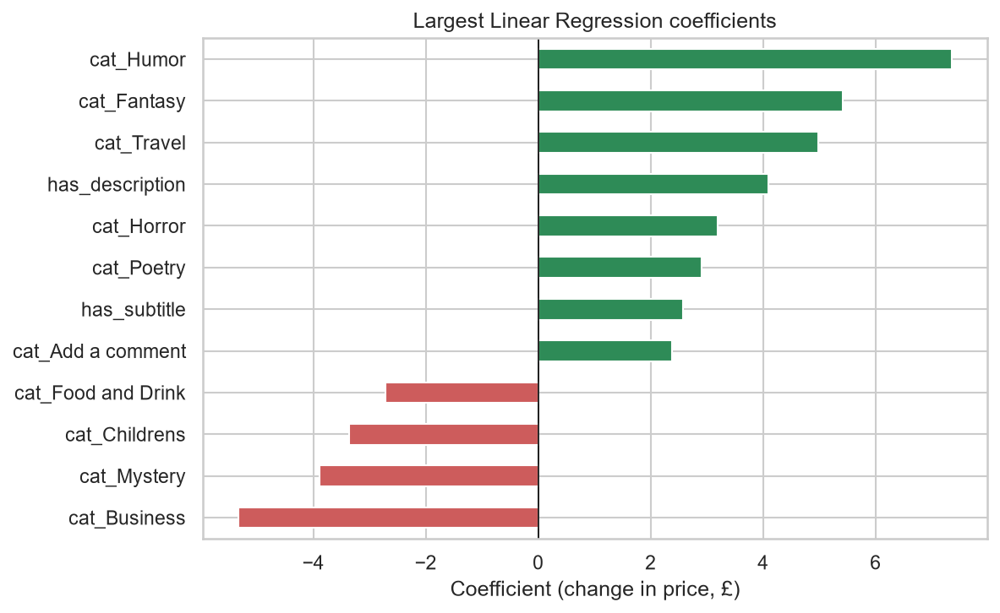
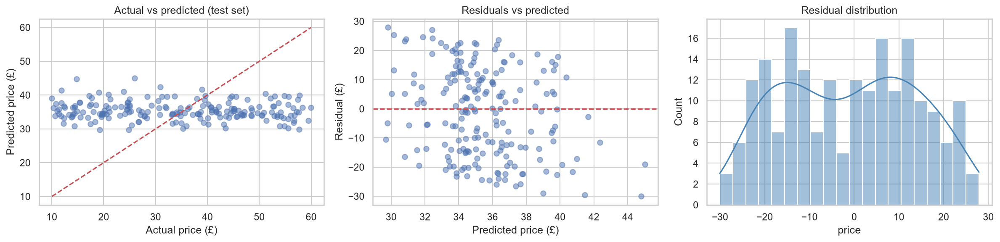

# Book Catalogue Analysis and Price Prediction: Books to Scrape

Prepared for: Publishing Analytics Team  |  Prepared by: ____________________

## 1. Executive Summary

We scraped 1000 books across 50 categories from Books to Scrape, cleaned the data, explored price, rating, genre and stock patterns, and fitted a Linear Regression to estimate price. Prices average £35.07 (median £35.98) and range from £10.00 to £59.99. The final model explains very low variation in price (test R² = -0.08) with a typical error of £13.05.

- Star rating and price have a negligible relationship (Spearman ρ = 0.03, p = 0.356).
- Category does not produce statistically detectable price differences (p = 0.919); category means range from £31.41 (Food and Drink) to £39.79 (Travel).
- The available public fields predict price only weakly, so a pricing tool built on them alone would not be reliable.

## 2. Methodology

### 2.1 Data acquisition

Data was collected with Python (requests and BeautifulSoup). The scraper walks all listing pages by following the next-page link, reads title, price, star rating (a CSS class) and availability, and then opens every product page for category, exact stock quantity and description. Requests are delayed, retried on failure and use a User-Agent header. The raw dataset has 1000 rows, above the 200-book minimum.

### 2.2 Data cleaning

Prices were converted from text (e.g. '£51.77') to numbers; star-rating words (One to Five) were mapped to 1 to 5; availability text was split into an in-stock flag and a quantity; descriptions were stripped of scraping artefacts and cleaned (lower-case, stop-words removed). Books without a description were kept and flagged rather than deleted. Rows with no price or rating would have been dropped because price is the target. Categories with fewer than 10 books were grouped as 'Other' for modelling. Constant columns (tax, product type, review count) were removed. Price outliers were reviewed and retained because they are valid listed prices.

### 2.3 Exploration and modelling

Relationships were explored with histograms, box plots, bar charts, scatter plots, a correlation matrix and keyword frequencies. The model is an ordinary least squares Linear Regression predicting price from rating, stock quantity, description length, title length, series and subtitle indicators and category. Data was split 80/20 into training (800) and test (200) sets, evaluated with MAE, RMSE and R², compared with a mean-price baseline, and checked with 5-fold cross-validation.

## 3. Key Insights

### 3.1 Pricing landscape

Price is roughly symmetric (skewness -0.04) with a standard deviation of £14.45, so prices are spread widely across the range rather than clustered around one level.

*Figure 1: Distribution of book prices*

### 3.2 Ratings

Mean price by star rating is shown below. The relationship between rating and price is negligible (ρ = 0.03); price does not differ detectably between rating groups, so a higher rating does not imply a higher price in this catalogue.

*Figure 2: Rating counts, price by rating and mean price by rating*

### 3.3 Genres

The largest category is Default with 152 books. Differences between genres are small relative to the spread within each genre (p = 0.919).

*Figure 3: Category sizes, mean price and mean rating*

### 3.4 Stock, titles and descriptions

100% of books are in stock, with an average of 8.6 units. Correlation of stock quantity with price is negligible (ρ = -0.01). Description length (ρ = 0.06) and title length (ρ = 0.03) show negligible relationships with price. Series titles (313 books) differ from standalone titles by £0.10 on average. Common description words include new, life, world, time, love.

*Figure 4: Price against description length, title length and series status*

*Figure 5: Correlation matrix*

## 4. Modelling Outcomes

*Table 1: Linear Regression performance*

| Model | MAE (£) | RMSE (£) | R2 |
|---|---|---|---|
| Linear Regression (train) | 12.179 | 14.185 | 0.032 |
| Linear Regression (test) | 13.051 | 15.049 | -0.078 |
| Mean baseline (test) | 12.662 | 14.53 | -0.005 |

On unseen test data the model achieves R² = -0.08, MAE = £13.05 and RMSE = £15.05, compared with a baseline MAE of £12.66 for always predicting the mean (the model is not meaningfully better than the baseline). Five-fold cross-validated R² is -0.07 (± 0.01); without category it is -0.02. Because R² is low, most of the variation in price is not captured by these features. A negative test R² means the model predicted unseen books worse than simply using the average price.

*Table 2: Largest coefficients*

| Feature | Coefficient (£) |
|---|---|
| cat_Humor | 7.354 |
| cat_Fantasy | 5.424 |
| cat_Business | -5.331 |
| cat_Travel | 4.983 |
| has_description | 4.099 |
| cat_Mystery | -3.887 |
| cat_Childrens | -3.361 |
| cat_Horror | 3.2 |

*Figure 6: Largest regression coefficients*

*Figure 7: Model diagnostics*

Limitations: only public listing fields were available (no author, publisher, page count, publication year or sales); Linear Regression assumes additive, straight-line effects; the dataset is modest in size with many small categories; and the source site states that its prices and ratings were randomly assigned, so weak predictability is expected and conclusions should not be generalised to real bookstores.

## 5. Practical Implications

- Star rating alone should not be used to set or judge price in this catalogue.
- Separate genre price tiers are not supported by this data; genre should not be the main basis for pricing decisions.
- Price cannot be reliably predicted from listing fields alone; richer data is needed before automating pricing.

## 6. Recommendations

### Retailers

- Benchmark each title against the median price of its category (Figure 3) rather than against its star rating.
- Use the model only as a sanity check for outlier prices, not as an automatic pricing engine, unless performance improves.

### Publishers

- Collect and test additional drivers such as page count, format, author profile, publication year and sales history before setting list prices.
- Track whether series titles justify a premium or discount in your own sales data.

### Data-driven book buyers

- Do not assume a higher-rated book costs more or less; compare price within the same category.
- Titles priced furthest below the model's expectation may be worth a closer look, treating the list as a starting point only because model accuracy is limited (Table 3).

*Table 3: Titles priced furthest below model expectation*

| title | category | price | predicted |
|---|---|---|---|
| Hyperbole and a Half: Unfortunate Situations, Flawed Coping Mechanisms, Mayhem, and Other Things That Happened | Humor | 14.75 | 44.81 |
| Old School (Diary of a Wimpy Kid #10) | Humor | 11.83 | 41.45 |
| The Tipping Point: How Little Things Can Make a Big Difference | Add a comment | 10.02 | 39.0 |
| The Lucifer Effect: Understanding How Good People Turn Evil | Psychology | 10.4 | 38.64 |
| The Long Shadow of Small Ghosts: Murder and Memory in an American City | Crime | 10.97 | 39.01 |

## 7. Next Steps

Add richer features (publisher, page count, publication year, author), test non-linear models such as random forests for comparison, and repeat the analysis on a dataset where prices are real.
